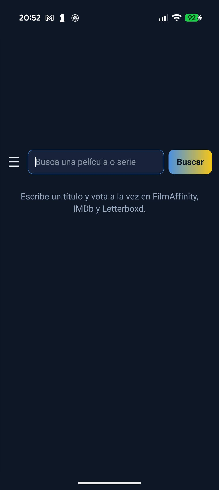
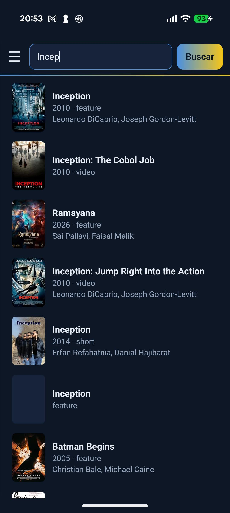
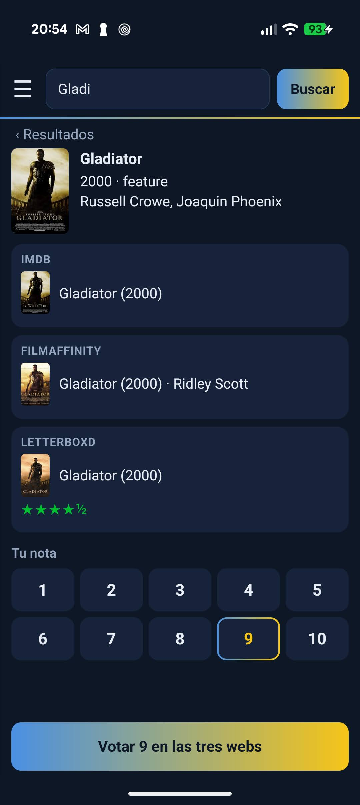
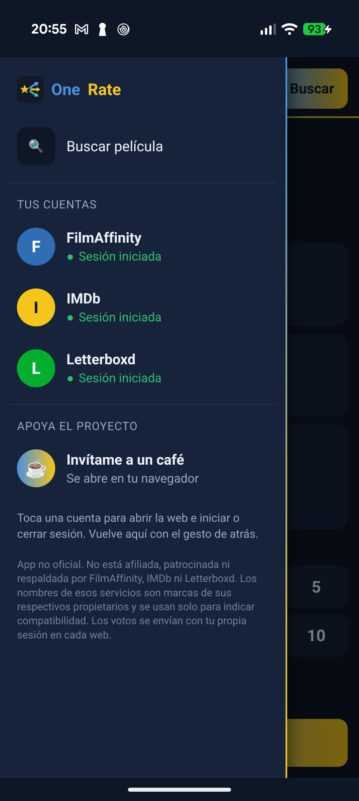

<h1 align="center">OneRate</h1>

**Rate once, everywhere.** Rate a movie **once** and your rating is saved on **FilmAffinity**, **IMDb** and **Letterboxd** at the same time.

  
  &nbsp;
  

<b>👉 <a href="https://github.com/neoruben/OneRate/releases/latest">Download OneRate</a></b> — open the page, tap the <code>OneRate-x.y.z.apk</code> file under <i>Assets</i> and install it on your phone.

Free and open-source Android app.

> **Unofficial app.** Not affiliated with, sponsored or endorsed by FilmAffinity, IMDb or Letterboxd. Those service names are trademarks of their respective owners and are used only to indicate compatibility.

*[Versión en español más abajo](#-en-español)*

## Screenshots

  
  
  
  

## Features

- Search movies and series as you type, with poster, year and cast.
- Finds the same movie on FilmAffinity (by title and year) and on Letterboxd (by its IMDb ID). If it isn't sure, it lets you pick.
- Pick your rating from 1 to 10 and it's sent to every site you're signed in to. On Letterboxd it's converted to stars (7 → ★★★½).
- Only the sites where you're signed in are shown and rated.
- Side menu showing your sign-in status on each site. After signing in, the app takes you back to the search automatically.
- English and Spanish (follows your phone's language).

## Installation

1. Download the latest `OneRate-x.y.z.apk` from **[the download page](https://github.com/neoruben/OneRate/releases/latest)** (under *Assets*).
2. Open it on your phone. Android will ask you to allow installing from that app (browser or file manager): accept.
3. Open OneRate, tap **☰** and sign in to FilmAffinity, IMDb and/or Letterboxd. You only need to do this once.

Requires Android 8.0 or newer (64-bit ARM).

## Privacy

- The app **doesn't collect or send any data** to any server of its own. No ads, no analytics.
- Your sessions (cookies) are stored only on your phone, inside the app.
- Ratings are sent directly from your phone to each site, with your own account.

## Disclaimer

The app automates, on your behalf, actions you would otherwise do by hand on each site. Those services' terms of use may not allow this: **use it at your own risk**. If a site changes its design, the app may stop rating on it until it's updated.

## How it works

- [GeckoView](https://mozilla.github.io/geckoview/) browser engine (Firefox's engine) with a built-in extension (`app/src/main/assets/votodoble/`).
- The extension opens the movie page on each site in the background and sets the rating just like you would.

To build it: open the project in Android Studio and press **Run**.

## License

[MIT](LICENSE)

---

## 🇪🇸 En español

**👉 [Descargar OneRate](https://github.com/neoruben/OneRate/releases/latest)** · ☕ [Invítame a un café](https://ko-fi.com/onerate)

**OneRate** te permite puntuar una película **una sola vez** y que la nota se guarde a la vez en **FilmAffinity**, **IMDb** y **Letterboxd**. Es una app para Android, gratuita y de código abierto.

> **App no oficial.** No está afiliada, patrocinada ni respaldada por FilmAffinity, IMDb ni Letterboxd.

**Instalación**

1. Descarga el último `OneRate-x.y.z.apk` desde **[la página de descarga](https://github.com/neoruben/OneRate/releases/latest)** (en *Assets*).
2. Ábrelo en el móvil y acepta instalar desde esa app (navegador o gestor de archivos).
3. Abre OneRate, toca **☰** e inicia sesión en las webs que uses. Solo hace falta una vez.

Requiere Android 8.0 o superior (64 bits, ARM). La app está en español si tu móvil está en español.

**Privacidad:** la app no recoge ni envía datos a ningún servidor propio; tus sesiones se quedan en tu móvil y los votos van directamente a cada web con tu cuenta.

**Aviso:** la app automatiza acciones que harías a mano en cada web, y sus condiciones de uso pueden no permitirlo. Úsala bajo tu responsabilidad.
