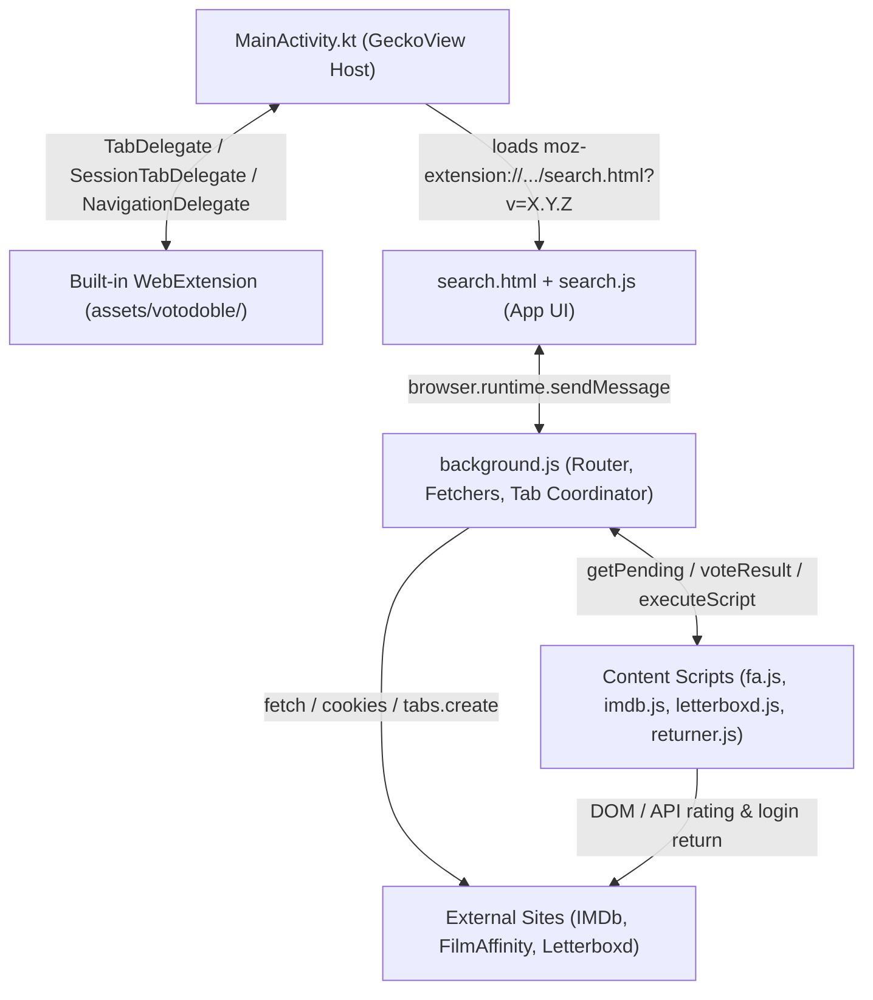

# OneRate — Technical Documentation & Architecture

This document describes how **OneRate** is structured, how the Android host communicates with the built-in WebExtension, how each movie service is queried and rated, and how to build, sign, and publish releases.

---

## 1. High-Level Architecture

OneRate is an Android wrapper around Mozilla **GeckoView** that bundles a Manifest V3 WebExtension under `app/src/main/assets/votodoble/`. All UI, search, matching, average-rating fetching, trivia loading, and multi-site voting logic lives inside that extension, while `MainActivity.kt` manages the GeckoView lifecycle, tabs/popups, window insets, focus/IME, and external links.



---

## 2. Repository Structure

```text
OneRate/
├── app/
│   ├── build.gradle.kts                     # Android config, GeckoView dep, debug/release variants, signing
│   └── src/main/
│       ├── AndroidManifest.xml              # Single Activity, INTERNET permission, adjustResize
│       ├── java/com/onerate/app/
│       │   └── MainActivity.kt              # GeckoRuntime/GeckoSession host, extension installer, delegates
│       ├── assets/votodoble/                # Built-in Manifest V3 WebExtension
│       │   ├── manifest.json                # Extension metadata, permissions, content_scripts, version
│       │   ├── search.html                  # Main app UI (search bar, drawer, movie card, trivia, rating bar)
│       │   ├── search.js                    # UI logic, i18n (EN/ES), search debounce, rating flow
│       │   ├── background.js                # Message router, scrapers/parsers, cookie checks, tab voting
│       │   ├── common.js                    # Shared helpers (waitFor, DOM builder, floating toast)
│       │   ├── imdb.js                      # IMDb content script (automated rating + manual vote detection)
│       │   ├── fa.js                        # FilmAffinity content script (desktop & mobile m.filmaffinity.com)
│       │   ├── letterboxd.js                # Letterboxd content script (triggers MAIN-world API rating)
│       │   ├── returner.js                  # Auto-returns to search.html once login succeeds
│       │   ├── options.html / options.js    # Extension options (standalone browser compatibility)
│       │   └── icon-*.png                   # Extension icons (16..128 px)
│       └── res/                             # Android layout, launcher icons, theme, backup rules
├── assets/                                  # Store/README icon and GitHub social preview
├── screenshots/                             # Combined README screenshots
├── gradle/libs.versions.toml                # AGP, Kotlin, AndroidX versions
├── CHANGELOG.md                             # Version history
└── README.md                                # User documentation (EN + ES)
```

---

## 3. Android Host (`MainActivity.kt`)

### Runtime & Session Management
- **Single `GeckoRuntime`:** Created once per process (`sRuntime`), configured with the device's locale (`Locale.getDefault().toLanguageTag()`). Remote debugging (`about:debugging`) is enabled **only** in debuggable builds (`ApplicationInfo.FLAG_DEBUGGABLE`) so release builds never expose session cookies over USB.
- **Sessions:**
  - `mainSession` displays `search.html` (or external sign-in pages opened from the drawer).
  - `extraSessions` holds child `GeckoSession` instances created for web popups (e.g., "Sign in with Google/Amazon/Apple" via `NavigationDelegate.onNewSession`) and hidden background voting tabs (`WebExtension.TabDelegate.onNewTab`).
  - Following GeckoView's contract, child sessions returned to `onNewTab`/`onNewSession` are created **unopened**; GeckoView opens and loads them. `showWhenOpen()` polls until `s.isOpen` before attaching active popups/tabs to `GeckoView`.

### Built-in Extension Installation & Upgrades (`installExtension`)
- Reads `"version"` from `assets/votodoble/manifest.json`.
- Lists installed extensions via `runtime.webExtensionController.list()`.
- If `onerate@onerate.app` is already installed with a **different version**, it uninstalls the old extension before calling `ensureBuiltIn(...)`.
  - **Why:** On an in-place upgrade, GeckoView does not automatically grant newly added `host_permissions`, whereas a fresh install does. Uninstalling and reinstalling the built-in extension preserves browser cookies/sessions.
  - **Important for developers:** Whenever you modify files under `app/src/main/assets/votodoble/`, bump `"version"` in `manifest.json` so existing installations pick up the changes.

### Focus, IME & Window Insets
- **Edge-to-edge & Keyboard:** `ViewCompat.setOnApplyWindowInsetsListener` applies `systemBars() or ime()` padding to `R.id.root` (paired with `android:windowSoftInputMode="adjustResize"`).
- **Focus & IME Recovery (`refocusVisible`):**
  - Navigating from an external HTTPS website (remote `sandboxed_tab` content process) back to `moz-extension://.../search.html` (extension/parent process) or closing a login popup can desynchronize GeckoView's `GeckoEditable` and Android's `InputMethodManager`.
  - `show(s)` deactivates/unfocuses the previous session, activates/focuses the newly visible session (`setActive(true)`, `setFocused(true)`, `setTabActive(s, true)`), requests Android view focus (`geckoView.requestFocus()`), and restarts the IME (`InputMethodManager.restartInput(geckoView)`).
  - `progressDelegate.onPageStop` purges history on `search.html` (so Back exits the app instead of walking back through login pages) and calls `refocusVisible(restartIme = true)`.
  - `onResume()` calls `refocusVisible(restartIme = false)`.

### Other Delegates
- **External Links:** URLs starting with `https://ko-fi.com/` or `https://github.com/neoruben/OneRate` are intercepted in `onLoadRequest` and launched in the phone's external browser (`ACTION_VIEW`).
- **Native `<select>` Menus:** `promptDelegate.onChoicePrompt` flattens `<optgroup>` entries and presents a standard Android `AlertDialog`.
- **Back Navigation (`goBack`):** Closes a visible child tab/popup first, then navigates back in `mainSession` if `mainCanGoBack`, and finally calls `finish()`.

---

## 4. Built-in WebExtension (`app/src/main/assets/votodoble/`)

### 4.1 Search & Rating UI (`search.html` & `search.js`)
- **Localization:** Follows `navigator.language` (`es` if Spanish, `en` otherwise). Also translates Spanish error messages from `background.js`/content scripts into English via `MSG_EN`.
- **Live Search:** Typing in `#q` triggers a 300 ms debounced `searchImdb` request once `q.length >= 2`. A monotonic `searchSeq` counter discards stale responses.
- **Movie Detail View (`showMovie`):**
  - Checks `loginStatus` (cached for 30 s, refreshed on `pageshow` and when opening the drawer) and shows only signed-in sites (or sites whose status could not be checked).
  - Fetches in parallel:
    - IMDb average rating (`avgImdb`)
    - IMDb trivia (`triviaImdb`)
    - Letterboxd match & average rating (`lbInfo`, resolved directly via `https://letterboxd.com/imdb/<ttId>/`)
    - FilmAffinity candidates (`findFa`), auto-selecting when confident or when a single candidate matches within ±1 year, otherwise showing a poster dropdown.
  - **IMDb Trivia Card:** Dynamically computes available vertical height inside `.trivia-wrap` and sets `-webkit-line-clamp` so the card expands to fill spare space without triggering scroll (hidden if fewer than 2 lines fit). Tapping cycles through up to 10 facts.
  - **Rating Bar & Sequential Voting:** Single-row `1..10` buttons (converted to half-stars `★`/`½` for Letterboxd). Tapping the vote button submits ratings **sequentially** (one hidden tab at a time) so resource usage stays low and status indicators (`#st-imdb`, `#st-fa`, `#st-lb`) update per site.
- **Side Drawer:** Displays live sign-in status for FilmAffinity, IMDb, and Letterboxd; tapping a site calls `watchLogin` (if signed out) and navigates to it. Also displays the app version passed via `?v=X.Y.Z` (persisted in `localStorage`).

### 4.2 Background Coordinator (`background.js`)

#### Message Protocol (`api.runtime.onMessage`)
| Message `type` | Sender | Purpose |
| --- | --- | --- |
| `searchImdb` | `search.js` | Queries IMDb suggestion JSON (`v3.sg.media-imdb.com/suggestion/x/...`) and returns titles, years, cast, and resized posters. |
| `findFa` | `search.js`, `common.js` | Searches FilmAffinity (`search.php`), parses desktop, mobile, or direct-redirect HTML with regexes, and ranks matches by title/year/director. |
| `findImdb` | `common.js` | Matches a FilmAffinity movie on IMDb using full/original/shortened queries and title/year/type scoring. |
| `lbInfo` | `search.js` | Resolves `letterboxd.com/imdb/<id>/` to title, poster thumbnail, and average rating (`/5`). |
| `avgImdb` / `avgFa` | `search.js` | Fetches and parses aggregate ratings and vote counts from IMDb / FilmAffinity pages. |
| `triviaImdb` | `search.js` | Fetches IMDb `/trivia/` (`/es-es/` first when `lang === 'es'`), parses non-spoiler items from `__NEXT_DATA__` (or HTML fallback), filters Spanish items with `isSpanish()`, and returns up to 10 concise facts. |
| `loginStatus` | `search.js`, `returner.js` | Checks IMDb cookies (`at-main`/`sess-at-main`), FilmAffinity search page HTML (retrying once if signed out to let "remember me" cookies renew), and Letterboxd cookies/homepage (`logged-in`/`logged-out`). |
| `watchLogin` | `search.js` | Sets a 10-minute `loginWatch` window for a site. |
| `loginReturnCheck` | `returner.js` | Checks if the watched site is now signed in and instructs `returner.js` to return to `search.html#signedin=<site>`. |
| `startVote` | `search.js`, `common.js` | Validates the target URL, opens an inactive tab (`active: false`), registers a 60 s timeout in `pending`, and awaits completion. |
| `getPending` | `imdb.js`, `fa.js`, `letterboxd.js` | Returns `{ site, rating }` if the current tab was opened for automated voting. |
| `faPageSelect` | `fa.js` | Fallback for FilmAffinity desktop: executes in `MAIN` world to update `bootstrap-select` via `window.jQuery`. |
| `lbRate` | `letterboxd.js` | Executes in `MAIN` world on Letterboxd to POST `rating=1..10` with `__csrf` token to `/s/film:<uid>/rate/`. |
| `voteResult` | `imdb.js`, `fa.js`, `letterboxd.js` | Resolves the pending vote promise; closes the tab on success or activates it (`active: true`) on failure so the user can finish manually. |

#### Sign-in Redirect Detection
`api.tabs.onUpdated` monitors pending voting tabs; if a site redirects to a sign-in URL (`/ap/signin`, `registration/signin`, `/login.php`, `letterboxd.com/sign-in`), the job fails fast and brings the tab to the foreground.

### 4.3 Site Content Scripts
- **`imdb.js`:** Clicks the hero rating button, waits for `.ipc-starbar__rating__button`, selects star `1..10`, submits `.ipc-rating-prompt__rate-button`, and verifies the updated score.
- **`fa.js`:** Supports both desktop (`www.filmaffinity.com`, `<select>` + jQuery fallback) and mobile (`m.filmaffinity.com`, `#wr-rat` modal list).
- **`letterboxd.js`:** Waits briefly on the loaded film page and asks `background.js` to run `lbRate` in the page's `MAIN` world.
- **`returner.js`:** Runs on all three domains; polls `loginReturnCheck` immediately and every 3 s while `watchLogin` is active, then calls `location.replace(search.html#signedin=<site>)`.
- **`common.js`:** Shared DOM/async helpers (`VD.waitFor`, `VD.h`, `VD.toast`) and `VD.offerVote` (used if the extension is run standalone in a desktop browser).

---

## 5. Building, Signing & Releasing

### Prerequisites
- **JDK 17** (e.g., Android Studio bundled JBR)
- **Android SDK** with `compileSdk = 37` (minor API level 2) and Build Tools (for `apksigner`)
- Gradle Wrapper (`./gradlew` / `gradlew.bat`)

### Build Variants (`app/build.gradle.kts`)
- **`debug` (`assembleDebug`):**
  - Application ID: `io.github.neoruben.onerate.debug` (`versionNameSuffix = "-debug"`) — installs alongside the release app without touching release sessions.
  - Remote debugging enabled (`about:debugging` in desktop Firefox).
- **`release` (`assembleRelease`):**
  - Application ID: `io.github.neoruben.onerate`.
  - Remote debugging disabled.
  - **R8 / minification disabled** (`optimization { enable = false }`) because R8 strips GeckoView JNI/reflection classes and causes startup crashes.
  - **ABI filter:** `arm64-v8a` only.
  - **Legacy JNI packaging:** `jniLibs { useLegacyPackaging = true }` compresses GeckoView native libraries inside the APK, cutting download size roughly in half (~96 MB).

### Release Signing (`keystore.properties`)
`app/build.gradle.kts` looks for `keystore.properties` (never committed to git) in this order:
1. `<repo-root>/keystore.properties`
2. `<repo-root>/../claves/keystore.properties`
3. `~/Documents/claves/keystore.properties`

File format:
```properties
storeFile=/absolute/path/to/onerate.jks
storePassword=...
keyAlias=...
keyPassword=...
```

If none of those files exist, `assembleRelease` produces an unsigned APK.

### Release Checklist
1. If any file in `app/src/main/assets/votodoble/` changed, bump `"version"` in `app/src/main/assets/votodoble/manifest.json`.
2. Increment `versionCode` and update `versionName` in `app/build.gradle.kts`.
3. Update `CHANGELOG.md` (and `README.md` if user-facing features changed).
4. Build the signed APK:
   ```bash
   ./gradlew assembleRelease
   ```
5. Verify the signature with `apksigner`:
   ```bash
   apksigner verify --verbose --print-certs app/build/outputs/apk/release/app-release.apk
   ```
6. Copy `app/build/outputs/apk/release/app-release.apk` to `OneRate-<version>.apk`, test on a device (`adb install -r OneRate-<version>.apk`), commit, tag `v<version>`, push, and create the GitHub Release attaching `OneRate-<version>.apk`.
